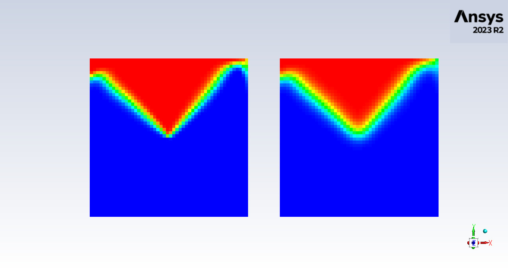
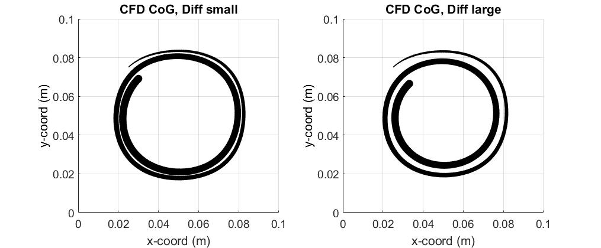
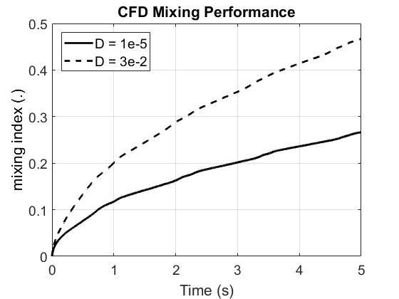
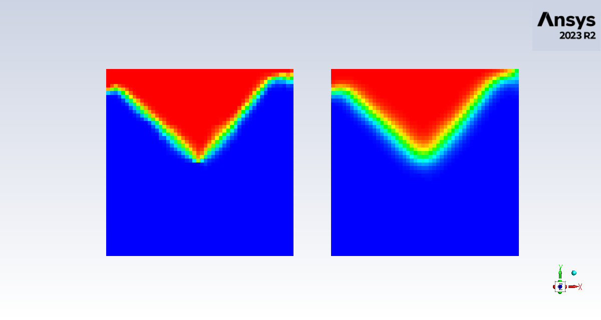
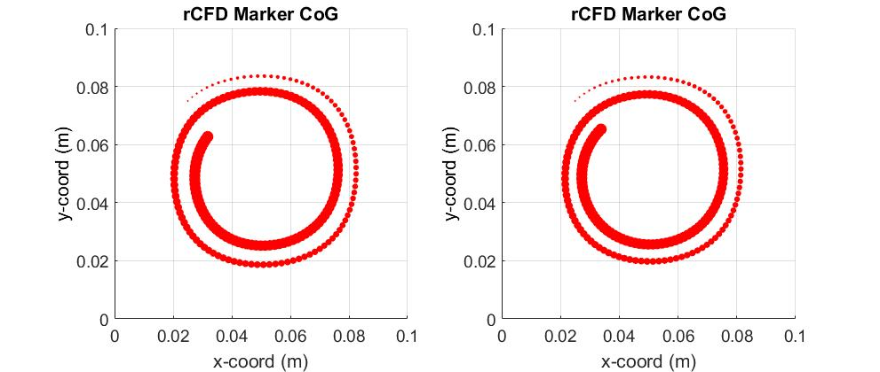
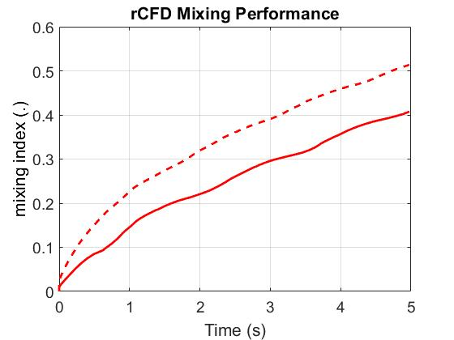

# A Tutorial Introduction to rCFD with ANSYS Fluent {#ansys_fluent_tutorial}

[TOC]

## Lid Driven Cavity


### Preface  {#tutorial0}

While all tutorials included in the rCFD software package can be executed by just following the instructions given in
the respective **README.md** files, this tutorial introduction presents a step-by-step tour through one of these example cases.
The aim of this tutorial is to provide a general understanding of the main concept of performing rCFD simulations with
ANSYS Fluent, especially with respect to simulation-level control (Sections 1-4) and solver-level rCFD control (Section 5).

Let's start with a quick examination of the files and folders in the rCFD project directory. Here, five main directories can be found:

- /doc
- /src
- /tests
- /third-party
- /tutorials

While **doc** contains documentation, **src** comprises the rCFD source code and **tutorials** hosts a set of example cases
(/tests and /third-party are not important at this point).
For instance, **tutorials/lid_driven_cavity_2d** serves as working directory for all associated (CFD and rCFD based) lid driven cavity simulations.
In the frame of this tutorial we will use the commercial software ANSYS Fluent to run all the conventional CFD simulations.


### 1. CFD Start-up Simulation {#tutorial1}

We now take a closer look at the **tutorials/lid_driven_cavity_2d** folder which contains four sub-folders
(note that this folder structure is common to all tutorials)

- /ansys_fluent
- /reference
- /post
- /user_src

In the first **ansys_fluent** sub-directory the conventional CFD case setup is
provided (in our  case **LidDrivenCavity_2D_INIT.cas.h5**, with the capital letter suffix `_INIT`
indicating the initial set-up file).

Secondly, **user_src** contains all user-defined functions for the CFD and rCFD simulations.
In case of conventional CFD simulations, post-processing monitors are defined in **CFD_user.c**.

Finally, in the **post** folder post_processing routines are provided for optional use and **reference**
contains example output files for comparison.

Back in the tutorial's working directory, we find another **README.md** file together with four scheme
files which serve as high-level control for the execution of CFD and rCFD simulations.

- README.md
- CFD_start.scm
- CFD_run.scm
- rCFD_prep.scm
- rCFD_run.scm

The tutorial's **README.md** file contains a quick-start guide for running the case including sample output.
The following **CFD_start.scm** and **CFD_run.scm** drive the conventional CFD simulations, 
while **rCFD_prep.scm** controls the generation of the
rCFD database and **rCFD_run.scm** defines the execution of the rCFD simulation.

At this point, let's open ANSYS Fluent from the working directory, e.g. by typing `fluent 3ddp –t2` in a
terminal window (i.e. we open the 3-dimensional CFD solver with double precision arithmetic on 2 cores).
Right away, load the control file **CFD_start.scm** into ANSYS Fluent (`File` -> `Read` -> `Scheme...`).
You may also open the scheme file in a text editor of your choice for closer inspection.
Upon loading, first scheme definitions are set:

```
(define ANSYS_Fluent_dir   "./ansys_fluent")
(define ANSYS_Fluent_file  "LidDrivenCavity_2D")   ; w/o _INIT...
(define CFD_user_src_dir   "./user_src")
(define CFD_post_dir       "CFD_start")
(define number_of_CFD_episodes      600)    ; sums up to 1min start-up time
(define simulation_timestep_width   0.01)
(define timesteps_per_CFD_episode   10)
```

with the first one e.g. defining the folder where the ANSYS Fluent case is to be found.
For a general scheme introduction, we refer to the book
[The Scheme Programming Language](https://www.scheme.com/tspl4/) (online version) by R. Kent Dybvig
and the [ANSYS Fluent scheme documentation](https://www.researchgate.net/publication/291103143_FLUENT_Scheme_Dokumentation)
(german) by M. Javurek.

After some variable definitions a first set of scheme commands is collected into a function:

```
(define (CFD_1)     ;; load all into main folder

    (ti-menu-load-string (format  #f "!cp ~a/~a_INIT.cas.h5 ." ANSYS_Fluent_dir ANSYS_Fluent_file))
    (ti-menu-load-string (format  #f "!cp ~a/CFD_user.c ." CFD_user_src_dir))
)

```

Essentially, `(CFD_1)` loads the ANSYS Fluent set-up file as well as the **CFD_user.c** file into the working directory of our tutorial.
These scheme commands are executed by simply entering `(CFD_1)` into the console of ANSYS Fluent.
In a second step, `(CFD_2)` compiles any user-defined functions into an ANSYS Fluent usable C library.

```
(define (CFD_2)     ;; compile everything into libudf_cfd

    (ti-menu-load-string "!rm -r libudf_cfd")

    (ti-menu-load-string "/define/user-defined/compiled-functions compile 
                        \"libudf_cfd\" yes 
                        \"CFD_user.c\" 
                        \"\" 
                        \"\"")

    (ti-menu-load-string "!rm CFD_user.c")
)

```

This library will be created in a separate folder of the current working directory such that we end up with five sub-directories:

- /ansys_fluent
- /libudf_cfd
- /reference
- /post
- /user_src

With these preparation steps finished, we can load the ANSYS Fluent case files by

```
(define (CFD_3)     ;; load start file, allocate UDMI's and load libudf_cfd

    (ti-menu-load-string (format #f "/file/read-case ./~a_INIT.cas.h5 OK" ANSYS_Fluent_file))

    (ti-menu-load-string "/define/user-defined/compiled-functions load \"libudf_cfd\"")

    (ti-menu-load-string "/solve/initialize/initialize-flow" )
)

```

Beside loading the case we also load the just compiled library of user-defined functions and
we additionally initialize our CFD data fields.
Next, we define any additional setting, we want to consider during conventional CFD simulations

```
(define (CFD4)      ;; additional settings before CFD run

    (ti-menu-load-string "/define/user-defined/function-hooks/execute-at-end 
                        \"CFD_write_energy::libudf_cfd\"
                         \"\"")
)
```

In this example, we just hook our user-defined monitor function to the CFD run
(Note, that our user function **CFD_write_energy** has been defined in **CFD_user.c** and
further that it has been compiled into **libudf_cfd** by the `(CFD_2)` command.

At this point we are ready to start the CFD simulation by

```
(define (CFD_5)     ;; run simulation w/o postprocessing

    (do  ((i  0 (+ i  1)))
        ((= i  number_of_CFD_episodes))

        (ti-menu-load-string (format #f "/solve/set/time-step ~d" simulation_timestep_width))
        (ti-menu-load-string (format #f "/solve/dual-time-iterate ~d 30" timesteps_per_CFD_episode))
    )
)
```
Here, we essentially simulate **number_of_CFD_episodes** times **timesteps_per_CFD_episode** CFD timesteps of timestep width
**simulation_timestep_width** (note that these quantities are defined at the top of **rCFD_start.scm**.


After completing our CFD simulation, the resulting ANSYS Fluent case and data files are stored into the working directory by

```
(define (CFD_6)     ;; write file

    (ti-menu-load-string (format #f "/file/write-case-data ./~a_START.cas.h5 OK" ANSYS_Fluent_file))
)
```
Note the file name convention with the suffix `_START` indicating that this instance of flow
represents a valid starting point for the generation of a database.

In a last step, the working directory is cleaned up by

```
(define (CFD_7)     ;; clean-up folder

    (ti-menu-load-string (format #f "!mkdir ./post/~a" CFD_post_dir))

    (ti-menu-load-string (format #f "!mv ./*.out ./post/~a" CFD_post_dir))
    (ti-menu-load-string (format #f "!mv ./*.trn ./post/~a" CFD_post_dir))
    (ti-menu-load-string (format #f "!mv ./*.jpg ./post/~a" CFD_post_dir))

    (ti-menu-load-string "!rm tmp*")
    (ti-menu-load-string (format #f "!mv ./*.h5 ./~a" ANSYS_Fluent_dir))
    (ti-menu-load-string "!rm log")
    (ti-menu-load-string "!rm *.flprj")
)
```

Note that any monitors (in our case **CFD_start_energy.out**) will be stored into **post/CFD_start**.
Finally, this monitor can be visualized by the MATLAB post-processing script **post/CFD_start_post.m** yielding a figure like this


For the sake of comparison, a corresponding pre-calculated sample monitor file is provided in the **reference** folder.

Instead of executing the scheme commands step by step, we could also run all of them by making use
of the collective scheme command `(CFD_start)` defined in the scheme file.

As a result, the folder structure is extended to

- /tutorials/lid_driven_cavity_2d
    - /ansys_fluent
    - /libudf_cfd
    - /reference
    - /post
        - /CFD_start
    - /user_src

At this point you can safely close ANSYS Fluent.

### 2. Run CFD reference simulation (optional) {#tutorial2}

- start ANSYS Fluent e.g. by **fluent 3ddp -t2 &** from this folder (with -t2 indicating the number of compute nodes)
- from the file menu read the scheme file **CFD_run.scm**
- type into the ANSYS Fluent console `(CFD_1)`, followed by `(CFD_2)`, ..., `(CFD_7)`; or simply `(CFD_run)`

    - mixing indices *CFD_mix_ind.out* will be stored into             ./post/CFD
    - center of gravity coordinates *CFD_CoG.out* will be stored into  ./post/CFD
    - animation snap-shots will be stored into                         ./post/CFD (200 files),  
      example snapshot for time-step 10...  
    
    - ANSYS Fluent transcript file *fluent_#data_#_#.trn* will be stored into ./post/CFD
    - two new files **LidDrivenCavity_2D_END_CFD_RUN.cas/dat.h5** will be stored into ./anysys_fluent

- post-process the CFD mixing simulation by running the Matlab code **CFD_reference.m** in the **post** folder

    - you should get two figures like this ...  
    
    

- close **ANSYS Fluent**
- for your convenience, sample output (i.e. CFD_mix_ind.out, CFD_CoG.out, CFD_mix_ind.out, CFD_mix_ind.jpg as well as one snap-shot CFD_mix_0010.jpg)
is provided in **reference**.

### 3. Creating an rCFD Database {#tutorial3}

As by now, we are able to run a conventional CFD simulation of lid driven cavity flow.
Furthermore, we have extended the existing pure flow simulation by passive species propagation,
which will serve as numerical validation base for subsequent rCFD simulations.
In this sub-section, we will run conventional CFD simulations in order to generate a database for rCFD simulations.

For this purpose, we restart ANSYS Fluent in our working directory and load the control file **rCFD_prep.scm**.
This scheme file essentially has the same structure as the control file for the pure CFD simulations.

Upon loading a set of scheme variables is defined.
Then `(rCFD_p1)` loads all necessary files into the working directory. Note that by

```
(ti-menu-load-string (format  #f "!cp ~a/*.c ." rCFD_src_dir))
(ti-menu-load-string (format  #f "!cp ~a/*.h ." rCFD_src_dir))
(ti-menu-load-string (format  #f "!cp ~a/*.h ." rCFD_user_src_dir))
```

all source files of the rCFD core code are temporarily loaded into our working directory.
While the core code essentially contains all functionalities of the rCFD methodology,
the very realization (i.e. which rCFD functions are chosen) is controlled by **rCFD_user_prep.h**
which is located in the sub-folder **user_src** of our working directory (cf. [Section 5](#tutorial5)).

```
(define (rCFD_p2)       ;; compile everything into libudf_rcfd_prep

    (ti-menu-load-string "!rm -r libudf_rcfd_prep") 

    (ti-menu-load-string "!mv  ./rCFD_user_prep.h ./rCFD_user.h")

    ;; load compile scheme
    (load (format  #f "~a/rCFD_C2C_prep_compile.scm" rCFD_src_dir) )

    (ti-menu-load-string "!rm  ./*.c")
    (ti-menu-load-string "!rm  ./*.h")
)
```

Similar to the pure CFD simulations, `(rCFD_p2)` compiles all the provided rCFD source files into the new library **libudf_rcfd_prep**
and `(rCFD_p3)` loads both – the ANSYS Fluent files with the `_START` suffix and the two libraries (for pure CFD and for rCFD preparation).

```
(define (rCFD_p3)       ;; load start file, allocate UDMI's, load libudf_rcfd_prep and init rCFD vars
;;;;;;;;;;;;;;;;;;;;;;;;;;;;;;;;;;;;;;;;;;;;;;;;;;;;;;;;;;;;;;;;;;;;;;;;;;;;;;;;;;;;;;;;;;;;;;;;;;;;;;;;;;;;;;;;

    (ti-menu-load-string (format #f "/file/read-case ./~a_START.cas.h5 OK" ANSYS_Fluent_file))

    (ti-menu-load-string "/define/user-defined/user-defined-memory 10 q" )
    (ti-menu-load-string "/define/user-defined/user-defined-node-memory 2 q" )

    (ti-menu-load-string "/define/user-defined/compiled-functions load \"libudf_cfd\"")
    (ti-menu-load-string "/define/user-defined/compiled-functions load \"libudf_rcfd_prep\"")

    (ti-menu-load-string (format #f "/file/read-data ./~a_START.dat.h5 OK" ANSYS_Fluent_file))

    (ti-menu-load-string "/define/user-defined/execute-on-demand \"rCFD_init_all::libudf_rcfd_prep\"")

    (ti-menu-load-string "/define/user-defined/execute-on-demand \"rCFD_write_Topo::libudf_rcfd_prep\"")
)
```

Note that with the last scheme command all rCFD functions will be initialized for the purpose of database generation 
and the grid topology will be written into a new **data/topo** folder.

The next command `(rCFD_p4)` defines any fluent settings which are additionally needed for the database generation.
Essentially, three scalar transport equations are defined which will trace convective displacement fields.

```
(define (rCFD_p4)      ;; settings database creation
;;;;;;;;;;;;;;;;;;;;;;;;;;;;;;;;;;;;;;;;;;;;;;;;;;;;;;;;;;;;;;;;;;;;;;;;;;;;;;;;;;;;;;;;;;;;;;;;;;;;;;;;;;;;;;;;

    (ti-menu-load-string "/define/user-defined/user-defined-scalars 
        3 no no
        phase-1  yes \"mass flow rate\" \"default\"
        phase-1  yes \"mass flow rate\" \"default\"
        phase-1  yes \"mass flow rate\" \"default\"")

    (ti-menu-load-string "/define/materials/change-create water water
        no no no no no no
        yes defined-per-uds
        0 constant 1
        1 constant 1
        2 constant 1
        -1
        no")

    (ti-menu-load-string "/solve/set/discretization-scheme/
        uds-0 1
        uds-1 1
        uds-2 1")

    (ti-menu-load-string "/define/boundary-conditions/set/wall
        1 6 7 11 12 13 14 16 17 18 ()
        phase-1
        uds
            yes yes \"udf\" \"rCFD_wall_bc::libudf_rcfd_prep\"
            yes yes \"udf\" \"rCFD_wall_bc::libudf_rcfd_prep\"
            yes yes \"udf\" \"rCFD_wall_bc::libudf_rcfd_prep\"
        uds-bc
            no yes
            no yes
            no yes
        q"
    )

    (ti-menu-load-string "/define/user-defined/function-hooks/execute-at-end
        \"CFD_write_gas_vol::libudf_cfd\"
        \"rCFD_execute_at_end::libudf_rcfd_prep\"
        \"\""
    )

    (ti-menu-load-string (format #f "/file/write-case-data ./~a_START_rCFD_PREP.cas.h5 OK" ANSYS_Fluent_file))
)

```

Finally, we run a CFD simulation with on-the-fly database generation.

```
(define (rCFD_p5)       ;; run CFD for monitoring

    (do  ((i  0 (+ i  1)))
            ((= i  number_of_monitoring_episodes))

        (ti-menu-load-string (format #f "/solve/set/time-step ~d" simulation_timestep_width))
        (ti-menu-load-string (format #f "/solve/dual-time-iterate ~d 30" monitoring_timesteps_per_episode))
    )
)
```

After completion of the database, the ANSYS Fluent files **LidDrivenCavity_2D_END_rCFD_PREP.cas/dat.h5**
are written by `(rCFD_p6)` before the recurrence path and the recurrence matrix are written by `(rCFD_p7)`.

Finally, all rCFD variable are freed by `(rCFD_p8)` and the working directory is cleaned up by `(rCFD_p9)`.
At this point the resulting folder structure reads

- /tutorials/lid_driven_cavity_2d
    - /ansys_fluent
    - /data
        - /c2c
        - /local_diff
        - /rec
        - /tmp
        - /user
        - /vof
    - /libudf_cfd
    - /libudf_rcfd_prep
    - /reference
    - /post
        - /CFD_start
        - /CFD
    - /user_src


### 4. Running an rCFD Simulation {#tutorial4}

By now, we have successfully built a database for an rCFD simulation of lid driven cavity flow.
In this section, we will actually run an rCFD simulation of species mixing.
For this purpose, we load the control file **rCFD_run.scm**.
This scheme file essentially has the same structure as the two control files we have presented above.
Upon loading, a set of scheme variables is defined.
Then `(rCFD_r1)` loads all necessary files into the working directory and `(rCFD_r2)` compiles the rCFD source code into **libudf_rcfd_run**.
Next, `(rCFD_r3)` reads the ANSYS Fluent files and initializes all rCFD functions for the purpose of run execution.
The subsequent command `(rCFD_r4)` actually reads the previously generated database before the rCFD run is executed by `(rCFD_r5)`.
As with pure CFD simulations, additional post-processing can be considered by `(rCFD_r5_post)`.

~~~~~~~~~~~~~~~~~~~~~~~~~~~~~~~~~~~~~~~~~~~~~~~~~~~~~~~~~~~~~~~~~~~~~~~~~~~~{.scm}
(define (rCFD_r4)

    (ti-menu-load-string "/define/user-defined/execute-on-demand \"rCFD_read_DB::libudf_rcfd_run\"")
)

(define (rCFD_r5)

    (do ((i 0 (+ i  1))) ((= i  number_of_rCFD_episodes))
        (ti-menu-load-string "/define/user-defined/execute-on-demand \"rCFD_run::libudf_rcfd_run\"")
    )
)
~~~~~~~~~~~~~~~~~~~~~~~~~~~~~~~~~~~~~~~~~~~~~~~~~~~~~~~~~~~~~~~~~~~~~~~~~~~~

Similar to the rCFD preparation step, the three remaining scheme commands `(rCFD_r6)`, `(rCFD_r7)` and `(rCFD_r8)` write
the resulting ANSYS Fluent files, free all rCFD memory and clean up the working directory.

Finally, all results of the rCFD simulation run are stored into **post/rCFD** and can be post-processed by **rCFD_post.m**.
Sample output include







The final folder structure reads
 
- /tutorials/lid_driven_cavity_2d
    - /ansys_fluent
    - /data
        - /c2c
        - /local_diff
        - /rec
        - /tmp
        - /user
        - /vof
    - /libudf_cfd
    - /libudf_rcfd_run
    - /libudf_rcfd_prep
    - /reference
    - /post
        - /CFD_start
        - /CFD
        - /rCFD
    - /user_src

### 5. Customizing an rCFD Simulation {#tutorial5}

In the last three sections we have seen how CFD and rCFD simulations are controlled by scheme files.
At some point, we mentioned that while **src** hosts the whole rCFD source code with all functionalities,
the actual realization can be customized by user input through **rCFD_user_prep.h** and  **rCFD_user_run.h**
which are located in the **user_src** sub-folder.

At this point we will just focus on the more complex **rCFD_user_run.h** file which has a very similar structure
as the **rCFD_user_prep** file.

On top level, **rCFD_user_run.h** is organized into five sections, namely

1. user definitions,
2. user dictionaries,
3. user initialization,
4. user data access and
5. user function registration.


#### 5.1. User Definitions

In the first section,

~~~~~~~~~~~~~~~~~~~~~~~~~~~~~~~~~~~~~~~~~~~~~~~~~~~~~~~~~~~~~~~~~~~~~~~~~~~~{.c}
// names of phases
enum{
    water,
    Phase_name_count
};
~~~~~~~~~~~~~~~~~~~~~~~~~~~~~~~~~~~~~~~~~~~~~~~~~~~~~~~~~~~~~~~~~~~~~~~~~~~~

e.g. defines the number of phases (in this case, we consider only single-phase flow, hence we have only one entry).
Similarly,

~~~~~~~~~~~~~~~~~~~~~~~~~~~~~~~~~~~~~~~~~~~~~~~~~~~~~~~~~~~~~~~~~~~~~~~~~~~~{.c}
enum{
    mix1,
    mix2,
    Data_name_count
};
~~~~~~~~~~~~~~~~~~~~~~~~~~~~~~~~~~~~~~~~~~~~~~~~~~~~~~~~~~~~~~~~~~~~~~~~~~~~

defines the number of data fields we want to propagate (in this case we consider two species with different diffusivities).
After a couple of other definitions,

~~~~~~~~~~~~~~~~~~~~~~~~~~~~~~~~~~~~~~~~~~~~~~~~~~~~~~~~~~~~~~~~~~~~~~~~~~~~{.c}
#if RP_NODE
    static int CoG_initialized = 0;
    ...
#endif
~~~~~~~~~~~~~~~~~~~~~~~~~~~~~~~~~~~~~~~~~~~~~~~~~~~~~~~~~~~~~~~~~~~~~~~~~~~~

defines and initializes a global variable that indicates whether the CoG monitor file should be opened in write mode or append mode.
The `#if` directive surrounding this section ensures that it is used only by compute nodes (cf. ANSYS Fluent Customization Manual).


#### 5.2. User Dictionaries

In the second section, the main user settings are communicated to the rCFD core code via dictionary entries.

~~~~~~~~~~~~~~~~~~~~~~~~~~~~~~~~~~~~~~~~~~~~~~~~~~~~~~~~~~~~~~~~~~~~~~~~~~~~{.c}

void user_set_solver_dict(void *handle)
{
    rcfd_set_dict_property_i(handle, "Solver_Dict", -1, -1, -1, "report_priority", RCFD_REPORT_INFO);
    rcfd_set_dict_property_r(handle, "Solver_Dict", -1, -1, -1, "global_time_step", 0.025);
    rcfd_set_dict_property_i(handle, "Solver_Dict", -1, -1, -1, "time_steps_per_monitoring_interval", 5);
    rcfd_set_dict_property_i(handle, "Solver_Dict", -1, -1, -1, "number_of_frames", 200);
    rcfd_set_dict_property_i(handle, "Solver_Dict", -1, -1, -1, "local_diff_on", 0);
    rcfd_set_dict_property_i(handle, "Solver_Dict", -1, -1, -1, "control_conc_sum_on", 0);  // since mix fields do not sum up to one
}

~~~~~~~~~~~~~~~~~~~~~~~~~~~~~~~~~~~~~~~~~~~~~~~~~~~~~~~~~~~~~~~~~~~~~~~~~~~~

By means of the function `user_set_solver_dict()`, we overwrite default values for general solver settings
(default values are given [here](userdoc.html#solver_dict)).
The first line sets the reporting mode which in our case is set to just informational output
(as opposed to e.g. **RCFD_REPORT_DEBUG**, which would result in way more output).
In the second line the global recurrence timestep is set to 0.025 seconds (thus overwriting the default value of 1 s).
The next line defines the number of pure CFD time-steps within an rCFD monitoring interval,
the fourth defines the number of frames stored in the database (which, in turn, defines the size of the database)
while the last entry just sets a flag to consider just global diffusion.
Note that depending on the type of value we want to set, the `rcfd_set_dict_property()` function takes a different suffix,
i.e. `_r` for real (floating point) values, `_i` for integer numbers or `_s` for character strings.

The next code sections consider the definition of [phases](userdoc.html#phase_dict)
(in rCFD each phase is associated with its own cell-to-cell shift patterns) and
[data](userdoc.html#data_dict) fields. In the first two phase settings, the water phase
is linked to two data fields and the phase density is set to 1000.0 (kg/m3). In the following
settings the data field's types are set to concentration (as opposed to e.g. temperature data)
and two diffusivities are defined.

~~~~~~~~~~~~~~~~~~~~~~~~~~~~~~~~~~~~~~~~~~~~~~~~~~~~~~~~~~~~~~~~~~~~~~~~~~~~{.c}
void user_set_phase_dict(void *handle)
{
#if RP_NODE
    rcfd_set_dict_property_i(handle, "Phase_Dict", -1, water, -1, "number_of_data", 2);
    rcfd_set_dict_property_r(handle, "Phase_Dict", -1, water, -1, "density", 1000.0);
#endif
    }

void user_set_data_dict(void *handle)
{
#if RP_NODE
    rcfd_set_dict_property_s(handle, "Data_Dict", -1, water, mix1, "type", "concentration");
    rcfd_set_dict_property_r(handle, "Data_Dict", -1, water, mix1, "face_swap_diffusion", 0.0001);

    rcfd_set_dict_property_s(handle, "Data_Dict", -1, water, mix2, "type", "concentration");
    rcfd_set_dict_property_r(handle, "Data_Dict", -1, water, mix2, "face_swap_diffusion", 0.4);
#endif
}
~~~~~~~~~~~~~~~~~~~~~~~~~~~~~~~~~~~~~~~~~~~~~~~~~~~~~~~~~~~~~~~~~~~~~~~~~~~~

The next and final dictionary we define the statistics (i.e., the way individual 
flow sequences are stitched together - in our case we opt for "replay").

~~~~~~~~~~~~~~~~~~~~~~~~~~~~~~~~~~~~~~~~~~~~~~~~~~~~~~~~~~~~~~~~~~~~~~~~~~~~{.c}
void user_set_rec_dict(void *handle)
{
    rcfd_set_dict_property_s(handle, "Rec_Dict", -1, -1, -1, "format", "replay");
}
~~~~~~~~~~~~~~~~~~~~~~~~~~~~~~~~~~~~~~~~~~~~~~~~~~~~~~~~~~~~~~~~~~~~~~~~~~~~

A complete list of configurable dictionary entries can be found in the [User Documentation](userdoc.html#dictionaries) section of this manual.

#### 5.3. User Initialization

In the third section of **rCFD_user_run.h**, we define initial values for the data fields under consideration.
After accessing the corresponding rCFD variables `cell_centers` and `cell_data`, we
just loop over all interior cells and depending on the cell's spatial position we define the water phase as being 'marked'.
Note that these markers don't have to sum up to one although we defined the data as `concentration` since we switched off the
`control_conc_sum_on` option in the solver dictionary.

Note that many internal rCFD variables (like the cell center positions or the data fields) can be accessed via getter and
setter functions of the rCFD library interface.
A complete list of these functions (and thus of accessible variables) can be found in the source code documentation of rCFD_library.c.

~~~~~~~~~~~~~~~~~~~~~~~~~~~~~~~~~~~~~~~~~~~~~~~~~~~~~~~~~~~~~~~~~~~~~~~~~~~~{.c}
void user_init_data(void *handle, const short i_layer)
{
#if RP_NODE

#if 1   // local vars

    int     i_cell;

    int     int_cell_count;

    double  **cell_center = NULL, **cell_data = NULL;

#endif

    // access data
    {
        int_cell_count  = rcfd_get_int_cell_count(handle, i_layer);

        cell_center = rcfd_get_cell_center(handle, i_layer);

        cell_data = rcfd_get_cell_data(handle, i_layer, water);

        if(!cell_data ||!cell_center){

            rcfd_report0(handle, RCFD_REPORT_ERROR, "user_init_data: var == NULL");

            return;
        }
    }

    // init data
    {
        for(i_cell = 0; i_cell < int_cell_count; i_cell ++){

            if((cell_center[i_cell][0] < 0.05) &&
               (cell_center[i_cell][1] > 0.05)){

                cell_data[i_cell][mix1] = 1.0;
                cell_data[i_cell][mix2] = 1.0;
            }
            else{
                cell_data[i_cell][mix1] = 0.0;
                cell_data[i_cell][mix2] = 0.0;
            }
        }
    }

    rcfd_report0(handle, RCFD_REPORT_INFO, "user_init_data: initialized marker fields");
#endif
}
~~~~~~~~~~~~~~~~~~~~~~~~~~~~~~~~~~~~~~~~~~~~~~~~~~~~~~~~~~~~~~~~~~~~~~~~~~~~

Finally, the `rcfd_report0()` command writes an information to the output stream of compute node-0.

#### 5.4. User Data Access

In the present case, the next section of **rCFD_user_run.h** contains only one function
defining the case-specific post-processing.
Additional data access functions might control in- and outflow conditions
(feel free to stroll through other tutorials for an exploration of that).

In our case, the `user_post` function is structured into five main parts.
Without diving into every detail their main functionality is as follows.

~~~~~~~~~~~~~~~~~~~~~~~~~~~~~~~~~~~~~~~~~~~~~~~~~~~~~~~~~~~~~~~~~~~~~~~~~~~~{.c}
void user_post(void *handle)
{
#if RP_NODE

#if 1   /* local vars */
#endif

    // access data
    {
        ...
    }

    // calc mean concs
    {
        ...
    }

    // calc dmean concs
    {
        ...
    }

    // node-0 writes mixing indices
    if(myid == 0){

        ...
    }

    // nodes write data to UDMI 
    {
        ...
    }

    rcfd_report0(handle, RCFD_REPORT_INFO, "user_post: set Fluent UDMI fields");

#endif
}
~~~~~~~~~~~~~~~~~~~~~~~~~~~~~~~~~~~~~~~~~~~~~~~~~~~~~~~~~~~~~~~~~~~~~~~~~~~~

In a first part, the rCFD variables of interest are accessed, by

~~~~~~~~~~~~~~~~~~~~~~~~~~~~~~~~~~~~~~~~~~~~~~~~~~~~~~~~~~~~~~~~~~~~~~~~~~~~{.c}
    // access data
    {
        i_layer = rcfd_get_current_layer(handle);

        int_cell_count = rcfd_get_int_cell_count(handle, i_layer);

        density = rcfd_get_phase_density(handle, water);

        current_time = rcfd_get_time(handle);

        cell_volume = rcfd_get_cell_volume(handle, i_layer);

        cell_data = rcfd_get_cell_data(handle, i_layer, water);

        cell_center = rcfd_get_cell_center(handle, i_layer);

        if(!cell_volume || !cell_data || !cell_center){

            rcfd_report0(handle, RCFD_REPORT_ERROR, "user_post: var == NULL");

            return;
        }
    }
~~~~~~~~~~~~~~~~~~~~~~~~~~~~~~~~~~~~~~~~~~~~~~~~~~~~~~~~~~~~~~~~~~~~~~~~~~~~

befor in the next two sections, e.g. mean concentration values are deduced from them
(for the sake of brevity only a shortened first code section is shown).

~~~~~~~~~~~~~~~~~~~~~~~~~~~~~~~~~~~~~~~~~~~~~~~~~~~~~~~~~~~~~~~~~~~~~~~~~~~~{.c}
    // calc mean concs
    {
        mass =        0.0;
        mass_mix1 =   0.0;
        mean_mix1 =   0.0;

        for(i_cell = 0; i_cell < int_cell_count; i_cell++){

            cell_mass = cell_volume[i_cell] * density;

            mass +=        cell_mass;
            mass_mix1   += cell_mass * cell_data[i_cell][mix1];
        }

        mass =        PRF_GRSUM1(mass);
        mass_mix1 =   PRF_GRSUM1(mass_mix1);

        if(mass > 0.0){

            mean_mix1 = mass_mix1 / mass;
        }
    }
~~~~~~~~~~~~~~~~~~~~~~~~~~~~~~~~~~~~~~~~~~~~~~~~~~~~~~~~~~~~~~~~~~~~~~~~~~~~
In this code section we loop over all interior cells of a given compute node and accumulate
the variables `mass` and `mass_mix1`.
After that we calculate the global sum of all compute node values by`PRF_GRSUM1` before
calculating the global mean.

In the next code section, we write these mean values to specific files (not detailed here,
since this code section represents just normal C-code).
Finally, we transfer rCFD data fields to ANSYS Fluent for subsequent post-processing.

~~~~~~~~~~~~~~~~~~~~~~~~~~~~~~~~~~~~~~~~~~~~~~~~~~~~~~~~~~~~~~~~~~~~~~~~~~~~{.c}
    // nodes write data to UDMI 
    {
        thread_loop_c(t,d){if(FLUID_CELL_THREAD_P(t)){begin_c_loop_int(i_fluent_cell, t){

            i_cell = fluent_get_partition_cell_id(i_fluent_cell, THREAD_ID(t));

            if((i_cell > 0) && (i_cell < int_cell_count)){

                C_UDMI(i_fluent_cell, t, 0) = cell_data[i_cell][mix1];
                C_UDMI(i_fluent_cell, t, 1) = cell_data[i_cell][mix2];
            }

        }end_c_loop_int(i_fluent_cell, t)}}
    }

    rcfd_report0(handle, RCFD_REPORT_INFO, "user_post: set Fluent UDMI fields");

#endif
}
~~~~~~~~~~~~~~~~~~~~~~~~~~~~~~~~~~~~~~~~~~~~~~~~~~~~~~~~~~~~~~~~~~~~~~~~~~~~

Here, we loop over ANSYS Fluent's cell thread and assign each ANSYS Fluent cell a corresponding rCFD data value.


#### 5.5. User Function Registration

In the remaining section of **rCFD_user_run.h** we have to register the functions, we used in order to control our rCFD simulation.
In our case this reads

~~~~~~~~~~~~~~~~~~~~~~~~~~~~~~~~~~~~~~~~~~~~~~~~~~~~~~~~~~~~~~~~~~~~~~~~~~~~{.c}
void user_register_functions(void *handle) {

    REGISTER_RCFD_UDF( user_set_solver_dict );
    REGISTER_RCFD_UDF( user_set_phase_dict );
    REGISTER_RCFD_UDF( user_set_data_dict );
    REGISTER_RCFD_UDF( user_set_rec_dict );

    REGISTER_RCFD_UDF( user_init_data );
    REGISTER_RCFD_UDF( user_post );
}
~~~~~~~~~~~~~~~~~~~~~~~~~~~~~~~~~~~~~~~~~~~~~~~~~~~~~~~~~~~~~~~~~~~~~~~~~~~~

where `REGISTER_RCFD_UDF` is a macro shortcut calling `rcfd_register_user_function()`.
For further details on registering user-defined functions and a complete list of registrable functions we refer to
the corresponding section in the [User Documentation](userdoc.html#register_user_defined_functions) part of this manual.


### 6. Conclusion {#tutorial6}

In order to run rCFD simulations, pure (conventional) CFD simulations have to be performed first to establish a database.
In this user tutorial, we presented four high-level scheme files, which control

1. spin-up CFD simulation until a valid start flow configuration is reached
2. pure CFD reference simulations for the purpose of producing numerical validation data,
3. CFD simulation with additional scalar transport equations for the generation of an rCFD database, as well as
4. rCFD simulation runs.

Furthermore, we presented a code-level user input file, which controls rCFD simulations by

1. user definitions
2. user dictionary settings
3. user data initialization
4. user data access (boundary conditions and soft sensing)
5. user function registration

While we presented this step-by-step approach just for the example of lid driven cavity flow,
the methodical approach remains the same for all other examples given in this repository.

**Congratulations – you just cleared the first hurdle on the way to mastering rCFD!**
