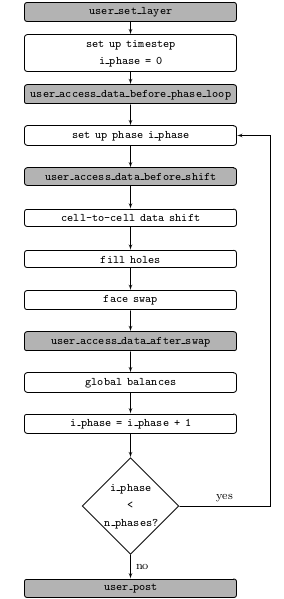

# User Documentation {#userdoc}

[TOC]

## Terminology

| Term                 | Meaning                                               |
|----------------------|-------------------------------------------------------|
| c0, c1               | the cells on either side of a face, or the start and end cells of a (cell-to-cell) shift |
| cell host            | the partition owning/hosting the cell                 |
| internal cell        | a cell hosted by the actual partition                 |
| external cell        | duplicate of a cell hosted by a neighboring partition |
| aligned cell         | one of four cells that can be used to interpolate a given (cell-to-cell) shift |
| tracer               | a massless particle tracking flow patterns            |
| (cell) crossing time | the time a tracer needs to cross a cell               |
| frame                | a snapshot of a CFD timestep                          |
| norm                 | the recurrence norm determining the similarity of two frames |
| sequence             | a number of consecutive frames                        |
| jump                 | the switchover to a new sequence                      |
| state                | the current flow state, i.e. the current database used |
| island               | a subregion of the simulation domain with an individual recurrence pattern (implementation incomplete) |
| layer                | cell resolution level, where higher layers mean lower resolution (implementation incomplete) |
| (cell-to-cell) shift | an operation to mimic the convection process          |
| (face) swap          | an operation to mimic the diffusion process           |

## Library Usage

An rCFD simulation is governed on the one hand by the database generated by the
user - which must at least include a cell-to-cell shift pattern file and a jump
vector file (cf. [File Formats](#file_formats)) - and on the other hand by the
settings in the [rCFD dictionaries](#dictionaries) and the execution of custom
code via [user-defined functions](#register_user_defined_functions).

### Overview

The rCFD library can be used in two modes.
In _preparation_ mode, the library will generate an rCFD database from (displacement)
field information fed in by a CFD simulation (e.g. ANSYS Fluent or OpenFOAM&reg;).
In _run_ mode, the library will execute an rCFD simulation using the generated
database.
In both cases, the usage of the rCFD library can be divided into six major steps:

| preparation                         | run                         |
|:-----------------------------------:|:---------------------------:|
| Creating an rCFD instance ||
| Registering user-defined functions ||
| Initializing the rCFD instance ||
| Creating the rCFD database          | Loading the rCFD database   |
| Computing the recurrence properties | Running the rCFD simulation |
| Destroying the rCFD instance ||

In the first step, an instance of the main rCFD object is created via `rcfd_open()`
or `rcfd_open_no_mpi()` - depending if one wants to use the rCFD library with
support for parallel MPI communication.
In a second step, one may register user-defined functions to change dictionary
settings or invoke custom code during an rCFD time step.
After these setup steps rCFD can properly initialize its internal data structures
when the `rcfd_init()` function is invoked.

In _preparation_ mode, the main functions for generating the rCFD database are
`rcfd_set_displacement_fields()` and `rcfd_create_shifts_from_displacement_fields()`.
While the former is intended to transfer displacement field data to the rCFD
library, the latter uses this information to generate cell-to cell shift patterns.
Invoking `rcfd_write_shifts()` at the end of a monitoring interval will add the
created cell-to-cell shifts to the rCFD database.
At the end of an rCFD database preparation, a call to `rcfd_write_recurrence()`
will compute the recurrence properties of the flow.

In _run_ mode, the rCFD database is loaded via `rcfd_read_db()`, after which the
library is ready to run the rCFD simulation.
Start the time stepping of the simulation by calling `rcfd_run()` to execute the
number of time steps defined in the [Solver_Dict](solver_dict.html) dictionary.
This run step can be repeated for as many episodes as desired.

Finally, a call to `rcfd_close()` destroys the given rCFD object and shuts down
the library.

### Customization of Simulations

Since each simulation case has specific demands, the rCFD library offers a high degree of customizability.
This flexibility is achieved by allowing user-defined functions to be registered to a set of predefined
function calls within the rCFD code.
These function calls are invoked at decisive points during initialization and time stepping of simulations.
That way, the execution of custom user code can greatly alter and precisely control the outcome of a simulation run.

#### Registering User-Defined Functions {#register_user_defined_functions}

To register a user-defined function use the `rcfd_register_user_function()`
function with the user function name you want to subscribe to and a pointer to
the function you want to register (which must have the correct function
signature) cast to a function pointer of the form `void(*)(void)`, e.g. define
a function like

~~~~~~~~~~~~~~~~~~~~~~~~~~~~~~~~~~~~~~~~~~~~~~~~~~~~~~~~~~~~~~~~~~~~~~~~~~~~{.c}
void my_set_solver_dict(void *handle) { /* set solver dict options */ }
~~~~~~~~~~~~~~~~~~~~~~~~~~~~~~~~~~~~~~~~~~~~~~~~~~~~~~~~~~~~~~~~~~~~~~~~~~~~

and register it like

~~~~~~~~~~~~~~~~~~~~~~~~~~~~~~~~~~~~~~~~~~~~~~~~~~~~~~~~~~~~~~~~~~~~~~~~~~~~{.c}
rcfd_register_user_function(myrcfd, "user_set_solver_dict", (void(*)(void))my_set_solver_dict);
~~~~~~~~~~~~~~~~~~~~~~~~~~~~~~~~~~~~~~~~~~~~~~~~~~~~~~~~~~~~~~~~~~~~~~~~~~~~

where `myrcfd` is a handle to the main rCFD object.
Note that only a single user-defined function can be registered to a specific function call in rCFD.
Registering a different user-defined function to the same function call will replace any previously
registered user-defined function.
The first parameter of all user-defined functions is a handle to the main rCFD object.
As a second parameter - if applicable - typically either the layer index or the phase index is given
in order to easily access the correct per-layer or per-phase properties, respectively.

| User Function Name                     | User Function Signature        | Invocation                                                              |
|----------------------------------------|--------------------------------|-------------------------------------------------------------------------|
| `"user_set_file_dict"`                 | `void udf(void*)`              | in `rcfd_init()`; allows to set [File_Dict](file_dict.html) properties      |
| `"user_set_solver_dict"`               | `void udf(void*)`              | in `rcfd_init()`; allows to set [Solver_Dict](solver_dict.html) properties  |
| `"user_set_phase_dict"`                | `void udf(void*)`              | in `rcfd_init()`; allows to set [Phase_Dict](phase_dict.html) properties    |
| `"user_set_prep_dict"`                 | `void udf(void*)`              | in `rcfd_init()`; allows to set [Prep_Dict](prep_dict.html) properties; only used in preparation mode |
| `"user_set_norm_dict"`                 | `void udf(void*)`              | in `rcfd_init()`; allows to set [Norm_Dict](norm_dict.html) properties; only used in preparation mode |
| `"user_set_rec_dict"`                  | `void udf(void*)`              | in `rcfd_init()`; allows to set [Rec_Dict](rec_dict.html) properties        |
| `"user_set_data_dict"`                 | `void udf(void*)`              | in `rcfd_init()`; allows to set [Data_Dict](data_dict.html) properties; only used in run mode |
| `"user_set_balance_dict"`              | `void udf(void*)`              | in `rcfd_init()`; allows to set [Balance_Dict](balance_dict.html) properties; only used in run mode |
| `"user_set_topo_dict"`                 | `void udf(void*)`              | in `rcfd_init()`; allows to set Topo_Dict properties (currently unused) |
| `"user_set_cell_dict"`                 | `void udf(void*,const short)`  | in `rcfd_init()`; allows to set [Cell_Dict](cell_dict.html) properties per layer |
| `"user_set_face_dict"`                 | `void udf(void*,const short)`  | in `rcfd_init()`; allows to set [Face_Dict](face_dict.html) properties per layer |
| `"user_set_node_dict"`                 | `void udf(void*,const short)`  | in `rcfd_init()`; allows to set [Node_Dict](node_dict.html) properties per layer |
| `"user_set_dump_dict"`                 | `void udf(void*)`              | in `rcfd_init()`; allows to set [Dump_Dict](dump_dict.html) properties      |
| `"user_pre_proc"`                      | `void udf(void*)`              | only used in (ANSYS Fluent) preparation mode when analyzing the CFD simulation |
| `"user_init_cells"`                    | `void udf(void*,const short)`  | in `rcfd_init()`; used to set the cell center coordinates and volumes per layer |
| `"user_init_faces"`                    | `void udf(void*,const short)`  | in `rcfd_init()`; used to set the cells on either side of each face and the face area vector per layer |
| `"user_init_nodes"`                    | `void udf(void*,const short)`  | in `rcfd_init()`; used to set the cell node coordinates and cell shapes per layer (used for VTK output) |
| `"user_init_cell_hosts"`               | `void udf(void*,const short)`  | in `rcfd_init()`; used to set the host partition of each cell per layer |
| `"user_init_data"`                     | `void udf(void*,const short)`  | in `rcfd_init()`; used to initialize user-defined data per layer        |
| `"user_post"`                          | `void udf(void*)`              | in `rcfd_init()` and `rcfd_run()`; used for custom post-processing      |
| `"user_set_layer"`                     | `short udf(void*,const short)` | in `rcfd_run()` at the beginning of each rCFD time step; the second parameter of this function indicates the currently active layer; the return value is used to set the new active layer |
| `"user_access_data_before_phase_loop"` | `void udf(void*)`              | in `rcfd_run()` at each rCFD time step after basic setup                |
| `"user_access_data_before_shift"`      | `void udf(void*,const short)`  | in `rcfd_run()` at each rCFD time step for each phase before shift operation |
| `"user_access_data_after_swap"`        | `void udf(void*,const short)`  | in `rcfd_run()` at each rCFD time step for each phase after face swap operation |
| `"user_set_norm"`                      | `void udf(void*)`              | in `rcfd_set_fields()`; only used in preparation mode |
| `"user_set_rec_vars"`                  | `void udf(void*,const short)`  | in `rcfd_set_fields()`; only used in preparation mode (per layer) |

#### Simulation Setup Customization {#customize_setup}

Dictionary options, grid topology, and initial data values can be set during the
initialization of rCFD (i.e. upon calling `rcfd_init()`) by registering corresponding
user-defined functions or setting up a [TOML](https://toml.io) configuration file.

In case of using user-defind functions, each of the `user_set_*_dict()` functions
allows to set properties of the respective dictionary by using the various
`rcfd_set_dict_property_*()` functions.
In case of using a configuration file, these dictionary properties can be specified
as key/value pairs in corresponding tables in a TOML configuration file
(cf. [Dictionaries](#dictionaries)).

- The [File_Dict](file_dict.html) dictionary allows to use custom names for the various
  files read and written by the rCFD library.
- The [Solver_Dict](solver_dict.html) dictionary deals with general simulation properties
  such as the number of phases and frames, the timestep, as well as sub-model flags
  and parameters.
- For each phase, a [Phase_Dict](phase_dict.html) dictionary handles phase-specific
  settings, e.g. density and heat capacity.
- The [Prep_Dict](prep_dict.html) dictionary allows to specify how tracers are updated
  during database generation and how neighbor cells are detected for creating additional
  cell-to-cell shifts during database generation.
  These settings are only applicable in preparation mode.
- The [Norm_Dict](norm_dict.html) dictionary offers some options for the calculation
  of the recurrence norm. These settings are only applicable in preparation mode.
- The [Rec_Dict](rec_dict.html) dictionary entries define the length of the frame
  sequences and how to navigate through the recurrence matrix.
- For each datum in each phase, a [Data_Dict](data_dict.html) dictionary details the
  type and propagation properties of the datum.
- The [Balance_Dict](balance_dict.html) dictionary allows to specify the type and
  accuracy of the balancing operation in rCFD runs.
- The [Cell_Dict](cell_dict.html) dictionary must be used to define the number of
  internal and external cells on a partition.
- The [Face_Dict](face_dict.html) dictionary must be used to define the number of
  internal and external faces on a partition.
- The [Node_Dict](node_dict.html) dictionary may be used to define the number of
  cell nodes on a partition.
- The [Dump_Dict](dump_dict.html) dictionary allows to specify the frequency with
  which dump files are written and what data to include.

For initializing the grid topology in the rCFD library, either topology files
must be provided (cf. [File Formats](#file_formats)) or user-defined functions
for the `user_init_cells()`, `user_init_faces()`, and `user_init_cell_hosts()`
functions must be registered.
In _preparation_ mode, the use of user-defined functions is the only option.

- The `user_init_cells()`         function must set the cell center coordinates and cell volumes.
- The `user_init_faces()`         function must set the cells on either side of each face and the face area vector.
- The `user_init_cell_hosts()`    function must set the host partition of each cell.

The `user_init_data()` function allows to initialize integral rCFD data as well
as user-defined data.
The functions `rcfd_get_cell_data()` or `rcfd_get_cell_user()` may for example
be used to directly access the desired data arrays.

#### Simulation Run Customization {#customize_run}

The user-defined functions `user_set_layer()`, `user_access_data_before_phase_loop()`,
`user_access_data_before_shift()`, `user_access_data_after_swap()`, and `user_post()`
are invoked when calling `rcfd_run()`.
Those functions allow to access data and execute custom code at specific points
during an rCFD timestep.
The figure below shows the activity diagram of a single timestep in rCFD and details
the calling of the relevant user-defined functions.
Analogous to the initialization phase, the functions `rcfd_get_cell_data()` may be used
for direct access to the rCFD data.

## File Formats {#file_formats}

All files except the cell-to-cell shift patterns are written in plain text format.
Floating point numbers are stored in scientific notation.
The base names of the files can be customized via the File dictionary

### Input Files

#### Mandatory Files

##### Cell-To-Cell Shift Pattern Files

These files describe the pattern of information transport between cells for a
specific state and phase.
Each partition loads a partition-specific file.
The naming scheme for these files is as follows:

*c2c_{state}_{phase}_{partition}*

The content of these files is structured as follows:

- for each frame:
    - internal shift count, external shift count
    - for each shift:
        - the list of cell-to-cell shift properties,
          e.g.: start cell, start partition, end cell, end partition, weight

##### Jump Vector File

These files define the end and start frames of a jump between sequences.
The naming scheme for these files is as follows:

*jump_{state0}_{state1}_{island}*

The content of these files is structured as follows:

- for each frame:
    - the frame with minimum distance (i.e. the start frame of the next sequence)

#### Case-Specific Files

##### Topology

These files define the grid topology information needed by rCFD.
Each partition loads a partition-specific file.
If no files are provided, topology data must be set via user defined functions
in the following way:
1. `"user_set_cell_dict"` to set the number of internal and external mesh cells
2. `"user_set_face_dict"` to set the number of internal and external mesh face
3. `"user_init_cells"` to set the center coordinates and volume of each cell
4. `"user_init_faces"` to set the cells on either side of each face as well as the face area vector
5. `"user_init_cell_hosts"` to set the host partition of each cell
The naming scheme for these files is as follows:

*topo_{partition}*

The content of these files is structured as follows:

- cell count, face count and node count
- for each cell:
    - cell center, cell volume and cell host (x y z volume host)
- for each face:
    - adjacent cells and face area vector (c0 c1 Ax Ay Az)
- for each node:
    - node position (x y z)
- for each cell:
    - in case of polyhedral cell type:
        - cell type, face count, face node counts, face nodes (type nfaces nface0nodes nface1nodes ... f0n0 f0n1 ... f1n0 f1n1 ...)
    - any other cell type:
        - cell type, cell nodes (type n0 n1 n2 ...)

##### VOF Files

These files store the volume of fluid field information for a specific state and
phase.
Each partition loads a partition-specific file.
The naming scheme for these files is as follows:

*vof_{state}_{phase}_{partition}*

The content of these files is structured as follows:

- for each frame:
    - cell count
    - for each cell:
        - the volume fraction of the phase

##### Local Diffusion Files

These files store the diffusivity field information for a specific state and
phase.
Each partition loads a partition-specific file.
The naming scheme for these files is as follows:

*local_diff_{state}_{phase}_{partition}*

The content of these files is structured as follows:

- for each frame
    - cell count
    - for each cell:
        - the momentum diffusivity (i.e. the kinematic viscosity (m2/s))

##### Recurrence User Data Files

These files store user-defined recurrence data for a specific state.
Each partition loads a partition-specific file.
The naming scheme for these files is as follows:

*rec_user_{state}_{partition}*

The content of these files is structured as follows:

- for each frame
    - cell count
    - for each cell:
        - the list of recurrence user data

### Output Files

#### Balance File

This file records the actual global mass integral and the targeted global mass
integral for each data of each phase every write step.

The content of this file is structured as follows:

- for each write step
    - for each phase
        - for each data
            - global run counter, phase index, data index, global mass integral, global mass integral target

#### Recurrence Frame File

This file records the actual sequence of frames during an rCFD simulation.

The content of this file is structured as follows:

- for each frame
    - the frame number

#### Dump Files

These files record the specified cell data values for each write step.
The data is stored in (legacy) [VTK](https://docs.vtk.org/) format.

#### Probe File

This file records the probed cell data values for each write step.
The data is stored in csv format.

## Dictionaries {#dictionaries}

Dictionary entries can be set by registering user-defined functions after
creating an instance of rCFD via `rcfd_open()` or `rcfd_open_no_mpi()` and prior to
initializing rCFD via `rcfd_init()`.
Alternatively, dictionary entries can also be specified as key/value pairs in
corresponding tables in a [TOML](https://toml.io) configuration file.
By default, rCFD is looking for a file named *config.toml* in the root directory
of a case setup and tries to read the dictionary entries from it.
(A different file name can be passed to the library in the `argv` parameter of
the rCFD open functions, e.g. `--config myconfig.toml`.)
If in addition to the configuration file a user-defined function is setting the
same dictionary property, the setting from the configuration file gets overwritten.
If a property is neither specified in the configuration file nor in a user-defined
function, a default value is used.

- @subpage file_dict
- @subpage solver_dict
- @subpage phase_dict
- @subpage prep_dict
- @subpage norm_dict
- @subpage rec_dict
- @subpage data_dict
- @subpage balance_dict
- @subpage cell_dict
- @subpage face_dict
- @subpage node_dict
- @subpage dump_dict

