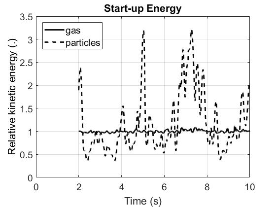
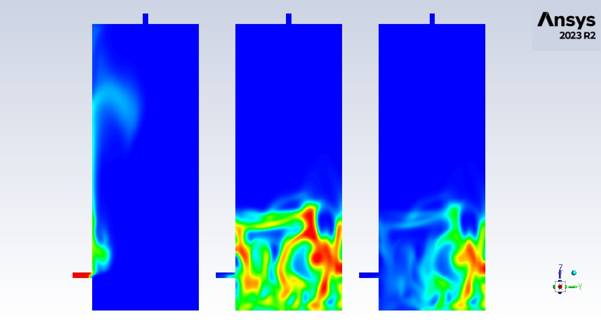
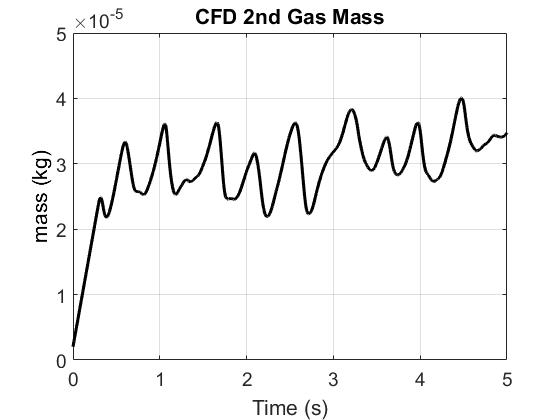
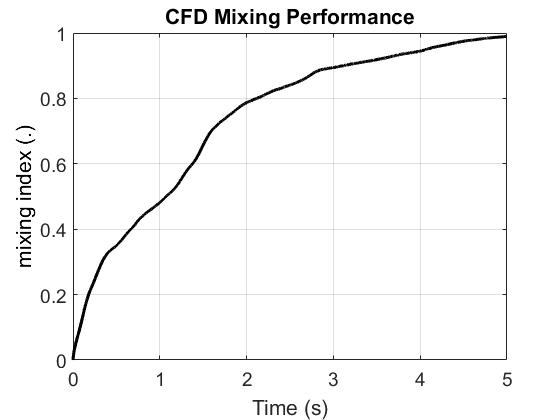
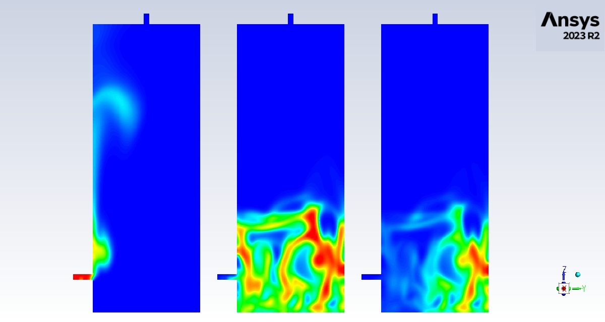
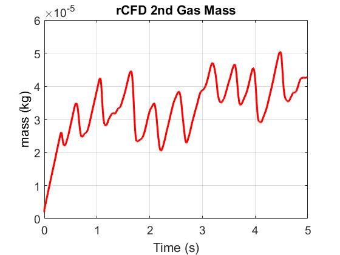
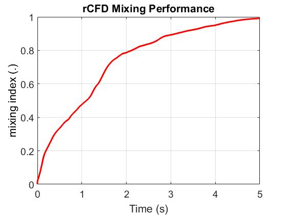

# Fluidized Bed Mixing Tutorial
(tested with ANSYS Fluent 2023 R2 and rCFD develop 26.03 on Linux)

## Contents

1. Spin-up CFD simulation until flow reaches pseudo steady-state
2. (optional) Run CFD reference simulation of gas and solids mixing
3. Create rCFD database
4. Run rCFD simulation of of gas and solids mixing

## 1. Spin-up CFD simulation

- start Ansys/fluent e.g. by **fluent 3ddp -t4 &** from this folder (with -t4 indicating the number of compute nodes)
- from the file menu read the scheme **cfd_start.scm**
- type into fluent console (cfd_1), followed by (cfd_2), ..., (cfd_7); or simply **(cfd_start)**

    - CFD user code will be compiled into **./libudf_cfd**
    - spin-up monitor **CFD_start_energy.out** will be stored into ./post/CFD_start
    - ANSYS/fluent transcript file **fluent_#date_#_#.trn** will be stored into  ./post/CFD_start
    - two new files **FluidizedBedMix_START.cas/dat.h5** will be stored into ./ansys_fluent

- post-process the CFD spin-up by running the Matlab code **./post/CFD_start_post.m**

    - you should get a figure like this ...  
      

- close **ANSYS/fluent**
- for comparison purposes, sample output (i.e. CFD_start_energy.out together with
the corresponding figure CFD_start_energy.jpg)
is provided in ./reference

## 2. Run CFD reference simulation (optional)

- start Ansys/fluent e.g. by **fluent 3ddp -t4 &** from this folder (with -t4 indicating the number of compute nodes)
- from the file menu read the scheme file **cfd_run.scm**
- type into fluent console (cfd_1), followed by (cfd_2), ..., (cfd_7); or simply **(cfd_run)**

    - mixing indices *CFD_mix_ind.out* will be stored into             ./post/CFD
    - secondary gas mass *CFD_mass.out* will be stored into            ./post/CFD
    - animation snap-shots will be stored into                         ./post/CFD (500 files),
      example snapshot for time-step 100...  
    
    - ANSYS/fluent transcript file *fluent_#data_#_#.trn* will be stored into ./post/CFD
    - two new files *FluidizedBedMix_END_CFD_RUN.cas/dat.h5* will be stored into ./ansys_fluent

- post-process the CFD mixing simulation by running the Matlab code **./post/CFD_reference.m**

    - you should get two figures like this ...  
      
      

- close **Ansys/fluent**
- for comparison purposes, sample output (i.e. CFD_mix_ind.out, CFD_mass.out,
CFD_mix_ind.jpg, CFD_mass.jpg as well as one snap-shot CFD_mix_00100.jpg) 
is provided in ./reference

## 3. Create rCFD database

- start Ansys/fluent e.g. by **fluent 3ddp -t4 &** from this folder (with -t4 indicating the number of compute nodes)
- from the file menu read the scheme **rcfd_prep.scm**
- type into fluent console (rcfd_p1), followed by (rcfd_p2), ..., (rcfd_p9); or simply **(rcfd_prep)**

    - rCFD code will be compiled into ./libudf_rcfd_prep
    - cell-to-cell shifts will be stored into    ./data/C2C        (8 files, i.e. two per-phase files for each node)
    - recurrence information will be stored into ./data/rec        (3 files, i.e jump, jump_diff, rec_matrix)
    - norm fields will be stored into            ./data/tmp        (2 files)
    - topo files will be stored into             ./data/topo       (2 files)
    - vof files will be stored into              ./data/topo       (8 files, i.e. two per-phase files for each node)
    - rCFD_prep.trn will be stored into          ./data
    - fluent_#data_#_#.trn will be stored into   ./data
    - rcfd_db.meta.toml will be stored into      ./data
    - two new files *FluidizedBedMix_START_rCFD_PREP.cas/dat.h5* will be stored into ./ansys_fluent

- close **Ansys/fluent**
- for comparison purposes, sample output (i.e. rcfd_db.meta.toml) is provided in ./reference

## 4. Run rCFD simulation

- (optional) edit the file **rcfd_run.scm** and set (define post_on 0) - in that case no graphical output will be produced, 
which significantly accelerates the subsequent rCFD simulations
- start Ansys/fluent e.g. by **fluent 3ddp -t4 &** from this folder (you must use the same number of nodes as for creating the database)
- from the file menu read the scheme **rcfd_run.scm**
- type into fluent console (rcfd_r1), followed by (rcfd_r2), ..., (rcfd_r8); or simply **(rcfd_run)**

    - rCFD code will be compiled into ./libudf_rcfd_run
    - rCFD_run.trn transcript will be stored into                             ./post/rCFD
    - for post_on = 1, animation snap-shots will be stored into               ./post/rCFD  (500 files),  
      example snapshot for time-step 10...  
    
    - ANSYS/fluent transcript file *fluent_#data_#_#.trn* will be stored into ./post/rCFD
    - rCFD_balance.out will be stored into                                    ./post/rCFD
    - rCFD_mix_ind.out will be stored into                                    ./post/rCFD
    - rCFD_mass.out will be stored into                                       ./post/rCFD
    - two new files *FluidizedBedMix_END_rCFD_RUN.cas/dat.h5* will be stored into ./ansys_fluent

- post-process the rCFD gas dissolution simulation by running the Matlab code **./post/rCFD_post.m**

    - you should get figures like this ...  
      
      

- close **Ansys/fluent**
- for comparison purposes, sample output (i.e. rCFD_mix_ind.out, rCFD_mix_ind.jpg, rCFD_CoG.out,
rCFD_CoG.jpg, rCFD_balance.out as well as one snap-shot rCFD_Mix_0100.jpg)
is provided in ./reference

## License

- This software is distributed under the [GNU General Public License](https://www.gnu.org/licenses/gpl-3.0.html).
- Copyright © 2026 JKU Linz
