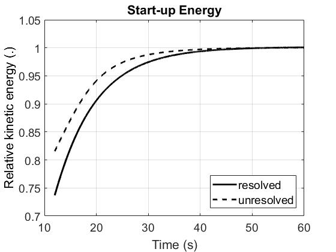

# Lid Driven Cavity 2D Tutorial
- Original: (tested with ANSYS Fluent 2023 R2 and rCFD develop 26.03 on Linux)
- Thesis: Modified for using in Windows (By Md Zahid Hasan) (Tested with ANSYS Fluent 2021 R2)
## Contents

1. Spin-up CFD simulation until flow reaches pseudo steady-state
2. (optional) Run CFD reference simulation of species transport
3. Create rCFD database
4. Run rCFD simulation of species transport

## 1. Spin-up CFD simulation

- Press Windows Key 
and type Fluent (i.e. Fluent 2021 R2) and You will get the Interface to select the working directory, Solver Process and GPU

- type into fluent console: **(load "CFD_start.scm") (CFD_start)**

    - CFD user code will be compiled into **./libudf_cfd**
    - spin-up monitor **CFD_start_energy.out** will be stored into ./post/CFD_start
    - ANSYS/fluent transcript file **fluent_#date_#_#.trn** will be stored into  ./post/CFD_start
    - two new files **LidDrivenCavity_2D_START.cas/dat.h5** will be stored into ./ansys_fluent

- post-process the CFD spin-up by running the Matlab code **./post/CFD_start_post.m**

    - you should get a figure like this ...  
      

- close **ANSYS/fluent**
- for comparison purposes, sample output (i.e. CFD_start_energy.out
together with the corresponding figure CFD_start_energy.jpg) 
is provided in ./reference

## 2. Run CFD reference simulation (optional)

- start Ansys/fluent in the same way of  **1. Spin-up CFD simulation**
- type into fluent console: **(load "CFD_run.scm") (CFD_run)**

    - mixing indices *CFD_mix_ind.out* will be stored into             ./post/CFD
    - center of gravity coordinates *CFD_CoG.out* will be stored into  ./post/CFD
    - animation snap-shots will be stored into                         ./post/CFD (200 files),  
    - ANSYS/fluent transcript file *fluent_#data_#_#.trn* will be stored into ./post/CFD
    - two new files *LidDrivenCavity_2D_END_CFD_RUN.cas/dat.h5* will be stored into ./ansys_fluent

- post-process the CFD mixing simulation by running the Matlab code **./post/CFD_reference.m** 
You will get the center of gravity like this:

- close **Ansys/fluent**
- for comparison purposes, sample output (i.e. CFD_mix_ind.out, CFD_CoG.out,
CFD_mix_ind.out, CFD_mix_ind.jpg as well as one snap-shot CFD_mix_0010.jpg) 
is provided in ./reference

## 3. Create rCFD database

- start Ansys/fluent in the same way but **do not use GPU this time** 

- type into fluent console: **(load "rCFD_prep.scm") (rCFD_prep)**

    - rCFD code will be compiled into ./libudf_rcfd_prep
    - cell-to-cell shifts will be stored into    ./data/C2C        (2 files, i.e.one file for each node)
    - local_diff fields will be stored into      ./data/local_diff (2 files)
    - recurrence information will be stored into ./data/rec        (3 files, i.e jump, jump_diff, rec_matrix)
    - norm fields will be stored into            ./data/tmp        (2 files)
    - topo files will be stored into             ./data/topo       (2 files)
    - rCFD_prep.trn will be stored into          ./data
    - fluent_#data_#_#.trn will be stored into   ./data
    - rcfd_db.meta.toml will be stored into      ./data
    - two new files *LidDrivenCavity_2D_START_rCFD_PREP.cas/dat.h5* will be stored into ./ansys_fluent

- close **Ansys/fluent**
- for comparison purposes, sample output (i.e. rcfd_db.meta.toml) is provided in ./reference

## 4. Run rCFD simulation

- (optional) edit the file **rcfd_run.scm** and set (define post_on 0) - in that case no graphical output will be produced, 
which significantly accelerates the subsequent rCFD simulations
- start Ansys/fluent in the same way of **3. Create rCFD database** (you must use the same number of nodes as for creating the database)
- type into fluent console: **(load "rCFD_run.scm") (rCFD_run)** (To run the given Scalar Diffusion)
    - rCFD code will be compiled into ./libudf_rcfd_run
    - rCFD_run.trn transcript will be stored into                             ./post/rCFD
    - for post_on = 1, animation snap-shots will be stored into               ./post/rCFD  (200 files),  
    - ANSYS/fluent transcript file *fluent_#data_#_#.trn* will be stored into ./post/rCFD
    - rCFD_balance.out will be stored into                                    ./post/rCFD
    - rCFD_mix_ind.out will be stored into                                    ./post/rCFD
    - rCFD_CoG.out will be stored into                                        ./post/rCFD
    - two new files *LidDrivenCavity_2D_END_rCFD_RUN.cas/dat.h5* will be stored into ./ansys_fluent

## 🧪 Test: Scalar diffusion with a circle at the top‑right corner

- Create a new file inside `user_src` named `rCFD_user_run_topright.h`  (`rCFD_user_run.h`) contains the scalar shape and position details to predict)
- start Ansys/fluent in the same way of **3. Create rCFD database**
- type into fluent console: **(load "rCFD_run_topright.scm") (rCFD_run)**
- and define the circle as scalar 1 using these parameters:

1.  Create the header file and define the parameters:
    
        /******************************************************************************
         * circle injection parameters  --  top-right corner of 0.065 x 0.065 domain
         *****************************************************************************/
        
        #define CX  0.065   /* circle centre x [m] */
        #define CY  0.065   /* circle centre y [m] */
        #define CR  0.005   /* circle radius   [m] */
        #define CZ  0.002   /* max depth z     [m] */
------------------------------------------------------------
- The Diffusivity values can be defined here in the `rCFD_user_run_topright.h` file
- {
#if RP_NODE
    rcfd_set_dict_property_s(handle, "Data_Dict", -1, WATER, MIX1, "type", "concentration");
    rcfd_set_dict_property_r(handle, "Data_Dict", -1, WATER, MIX1, "face_swap_diffusion", 0.00001);

    rcfd_set_dict_property_s(handle, "Data_Dict", -1, WATER, MIX2, "type", "concentration");
    rcfd_set_dict_property_r(handle, "Data_Dict", -1, WATER, MIX2, "face_swap_diffusion", 0.03);
#endif
}
2.  **Post-process** the rCFD gas dissolution simulation step contours are automatically recorded and plots are also automatically generated by the .py scripts

    - You should get figures like this:

        <table>
          <tr>
            <td></td>  
            <td></td>    
          </tr>
        </table>

3.  **Close** Ansys/Fluent.

4.  For **comparison purposes**, sample output (i.e. `rCFD_mix_ind.out`, `rCFD_mix_ind.jpg`, `rCFD_CoG.out`, `rCFD_CoG.jpg`, `rCFD_balance.out` as well as one snapshot `rCFD_mix_0010.jpg`) is provided in `./reference`.

    <table>
      <tr>
        <td></td>
        <td></td>
      </tr>
    </table>

[https://github.com/user-attachments/assets/7e69f84e-a0d4-4803-9b88-56af217def43](https://youtu.be/G8FhZ6GOaSc?si=5Z1XM8mu4s7g0zuM)

## License

- This software is distributed under the [GNU General Public License](https://www.gnu.org/licenses/gpl-3.0.html).
- Copyright © 2026 JKU Linz
