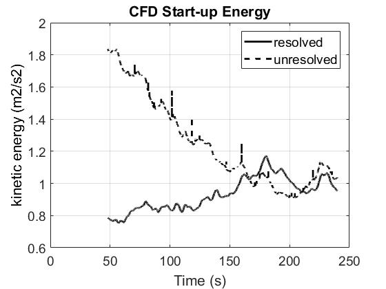
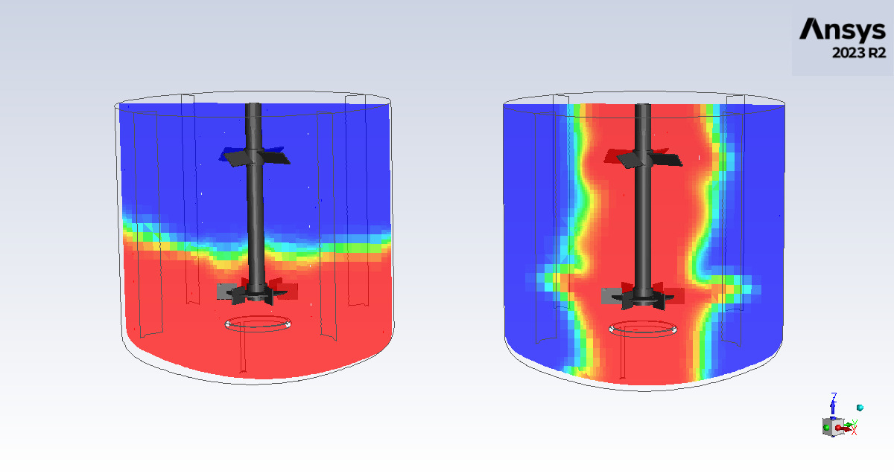
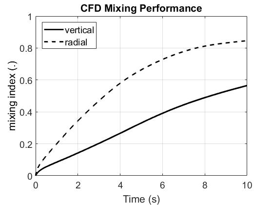
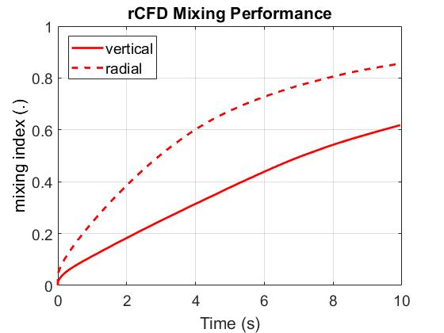

# Stirrer Single-Phase Tutorial
(tested with ANSYS Fluent 2023 R2 and rCFD develop 26.03 on Linux)

## Contents

1. Spin-up CFD simulation until flow reaches pseudo steady-state
2. (optional) Run CFD reference simulation of vertical and radial mixing
3. Create rCFD database
4. Run rCFD simulation of vertical and radial mixing

## 1. Spin-up CFD simulation

- (optional) edit **cfd_start.scm** and adapt the stirrer's rotation speed (default 40 rpm)
- start Ansys/fluent e.g. by **fluent 3ddp -t32 &** from this folder (with -t32 indicating the number of compute nodes)
- from the file menu read the scheme **cfd_start.scm**
- type into fluent console (cfd_1), followed by (cfd_2), ..., (cfd_7); or simply **(cfd_start)**

    - CFD user code will be compiled into **./libudf_cfd**
    - spin-up energy monitor **CFD_start_energy.out** will be stored into        ./post/CFD_start
    - ANSYS/fluent transcript file **fluent_#date_#_#.trn** will be stored into  ./post/CFD_start
    - two new files **Stirrer_SinglePhase_START.cas/dat.h5** will be stored into ./ansys_fluent

- post-process the CFD spin-up by running the Matlab code **./post/CFD_start_post.m**

    - you should get a figure like this ...  
    

- close **ANSYS/fluent**
- for comparison purposes, sample output (i.e. CFD_start_energy.out and the corresponding figure CFD_start_energy.jpg) 
is provided in ./reference

## 2. Run CFD reference simulation (optional)

- start Ansys/fluent e.g. by **fluent 3ddp -t32 &** from this folder (with -t32 indicating the number of compute nodes)
- from the file menu read the scheme file **cfd_run.scm**
- type into fluent console (cfd_1), followed by (cfd_2), ..., (cfd_7); or simply **(cfd_run)**

    - mixing indices *CFD_mix_ind.out* will be stored into             ./post/CFD
    - animation snap-shots will be stored into                         ./post/CFD (200 files)
    - example snapshot for time-step 10...  
    
    - ANSYS/fluent transcript file *fluent_#data_#_#.trn* will be stored into ./post/CFD
    - two new files *Stirrer_SinglePhase_END_CFD_RUN.cas/dat.h5* will be stored into ./ansys_fluent

- post-process the CFD mixing simulation by running the Matlab code **./post/CFD_post.m**

    - you should get a figure like this ...  

- close **Ansys/fluent**
- for comparison purposes, sample output (i.e. CFD_mix_ind.out, CFD_mix_ind.jpg as well as one snap-shot CFD_mix_0010.jpg) 
is provided in ./reference

## 3. Create rCFD database

- start Ansys/fluent e.g. by **fluent 3ddp -t32 &** from this folder (with -t32 indicating the number of compute nodes)
- from the file menu read the scheme **rcfd_prep.scm**
- type into fluent console (rcfd_p1), followed by (rcfd_p2), ..., (rcfd_p9); or simply **(rcfd_prep)**

    - rCFD code will be compiled into ./libudf_rcfd_prep
    - cell-to-cell shifts will be stored into    ./data/C2C        (32 files, i.e.one file for each node)
    - local_diff fields will be stored into      ./data/local_diff (32 files)
    - recurrence information will be stored into ./data/rec        ( 3 files, i.e jump, jump_diff, rec_matrix)
    - norm fields will be stored into            ./data/tmp        (32 files)
    - topo files will be stored into             ./data/topo       (32 files)
    - rCFD_prep.trn will be stored into          ./data
    - fluent_#data_#_#.trn will be stored into   ./data
    - rcfd_db.meta.toml will be stored into      ./data
    - two new files *Stirrer_SinglePhase_START_rCFD_PREP.cas/dat.h5* will be stored into ./ansys_fluent

- close **Ansys/fluent**
- for comparison purposes, sample output (i.e. rcfd_db.meta.toml) is provided in ./reference

## Run rCFD simulation

- start Ansys/fluent e.g. by **fluent 3ddp -t32 &** from this folder (you must use the same number of nodes as for creating the database)
- from the file menu read the scheme **rcfd_run.scm**
- type into fluent console (rcfd_r1), followed by (rcfd_r2), ..., (rcfd_r8); or simply **(rcfd_run)**

    - rCFD code will be compiled into ./libudf_rcfd_run
    - rCFD_run.trn transcript will be stored into                             ./post/rCFD
    - animation snap-shots will be stored into                                ./post/rCFD  (200 files)
    - example snapshot for time-step 10...
    
    - ANSYS/fluent transcript file *fluent_#data_#_#.trn* will be stored into ./post/rCFD
    - rCFD_balance.out will be stored into                                    ./post/rCFD
    - rCFD_mix_ind.out will be stored into                                    ./post/rCFD
    - two new files *Stirrer_SinglePhase_END_rCFD_RUN.cas/dat.h5* will be stored into ./ansys_fluent

- post-process the rCFD mixing simulation by running the Matlab code **./post/rCFD_post.m**

    - you should get a figure like this ...  
    

- close **Ansys/fluent**
- for comparison purposes, sample output (i.e. rCFD_mix_ind.out, rCFD_mix_ind.jpg, rCFD_balance.out as well as one snap-shot rCFD_mix_0010.jpg) 
is provided in ./reference

## License

- This software is distributed under the [GNU General Public License](https://www.gnu.org/licenses/gpl-3.0.html).
- Copyright © 2026 JKU Linz
